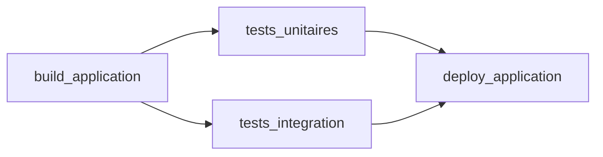

# Utilisation de `stages`, `stage` et `script` dans GitLab CI/CD

## Objectif

Construire un pipeline de démonstration avec un build, deux tests parallèles et un déploiement simulé, en reprenant la progression du cours Jenkins.

## 1. Correspondances avec Jenkins

| Jenkins | GitLab CI/CD |
| --- | --- |
| Bloc `stages` | Liste globale `stages` |
| `stage('Build')` contenant des étapes | Un job affecté au stage `build` avec `stage: build` |
| Bloc `steps` | Liste de commandes `script` du job |
| Bloc `parallel` avec deux tests | Deux jobs distincts affectés au même stage `test` |

Dans GitLab, **`stages` définit l'ordre**, **`stage` affecte un job à une phase**, et **`script` contient ses commandes**. Les jobs sont déclarés à la racine du YAML, en dehors de la liste `stages`.

## 2. Créer le pipeline

Prérequis : un runner disponible pour le projet accepte les jobs sans tags. Sinon, ajoutez les `tags` adaptés à chaque job, comme dans [la fiche sur les runners](0.runners.md).

Placez ce contenu dans `.gitlab-ci.yml`, à la racine du dépôt GitLab :

```yaml
stages:
  - build
  - test
  - deploy

build_application:
  stage: build
  script:
    - echo "Simulation de la compilation"

tests_unitaires:
  stage: test
  script:
    - echo "Simulation des tests unitaires"

tests_integration:
  stage: test
  script:
    - echo "Simulation des tests d'integration"

deploy_application:
  stage: deploy
  script:
    - echo "Simulation du deploiement"
```

Ces commandes affichent des messages pédagogiques ; elles seront remplacées par les commandes de votre application lors d'un projet pratique.

## 3. Comprendre l'exécution



1. Le build s'exécute.
2. Après sa réussite, les deux tests deviennent exécutables en parallèle.
3. Le déploiement attend la réussite des deux tests.

L'exécution simultanée dépend de la capacité des runners. Si un seul emplacement d'exécution est disponible, les tests passent l'un après l'autre.

Dans cet exemple, si un test échoue, le déploiement est ignoré ; l'autre test n'est pas automatiquement interrompu.

## 4. Exécuter et observer

1. Enregistrez `.gitlab-ci.yml` dans un commit et poussez-le sur GitLab.
2. Dans le projet, ouvrez **Build > Pipelines**.
3. Ouvrez le pipeline pour voir ses stages et ses jobs.
4. Cliquez sur un job pour consulter ses commandes et leur sortie.

GitLab propose une vue graphique intégrée du pipeline, sans plugin de visualisation à installer.

## 5. Équivalent des `steps` : `script`

Pour exécuter plusieurs commandes dans un job, ajoutez plusieurs lignes sous `script`. Voici un exemple autonome pour un runner Linux avec un shell compatible :

```yaml
demo_commandes:
  tags:
    - linux
  script:
    - echo "Affichage du repertoire courant"
    - pwd
    - echo "Liste des fichiers"
    - ls -la
```

Les commandes s'exécutent dans l'ordre. Le job utilise ici le stage `test`, attribué par défaut lorsque `stage` est absent.

Le mot `script` ne désigne pas un bloc Groovy comme dans Jenkins : les commandes sont interprétées par le shell configuré pour le runner. Adaptez-les à Linux ou Windows et installez les outils nécessaires dans l'environnement d'exécution.

## 6. Petit exercice

Dans le pipeline principal :

1. Ajoutez un job `analyse_code` dans le stage `test`, avec un simple message.
2. Relancez le pipeline : les trois jobs de test doivent précéder le déploiement.
3. Ajoutez `- exit 1` à la fin du `script` de `tests_unitaires`.
4. Relancez : le test échoue et le déploiement est ignoré.
5. Retirez cette commande pour retrouver un pipeline réussi.

## Pour la suite

Les conditions de branche et les validations manuelles seront traitées dans les thèmes dédiés. Le mot-clé `needs` permet aussi de définir des dépendances précises entre jobs et de dépasser l'ordre habituel des stages.

## Documentation officielle

- [Pipelines GitLab CI/CD](https://docs.gitlab.com/ci/pipelines/)
- [Référence YAML : stages](https://docs.gitlab.com/ci/yaml/#stages)
- [Référence YAML : script](https://docs.gitlab.com/ci/yaml/#script)
- [Dépendances avec needs](https://docs.gitlab.com/ci/yaml/needs/)
